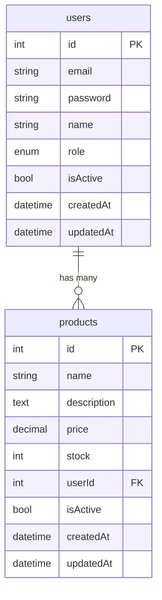
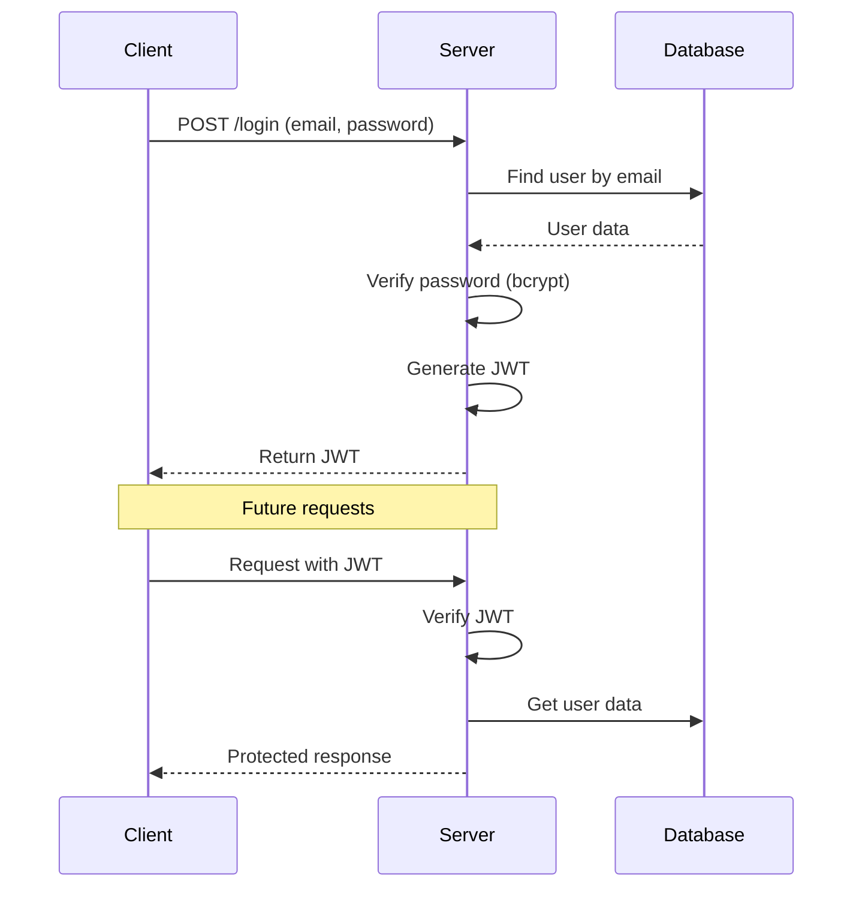
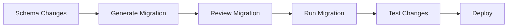

# Design Document

**Version:** 1.0.0
**Date:** 2026-07-22

---

## 🎨 Design Principles

### Core Design Principles

1. **Separation of Concerns**
   - Controller → Service → Model
   - Clear boundaries between layers
   - Single responsibility

2. **Dependency Injection**
   - Services injected into controllers
   - Models instantiated in services
   - Plugins registered at startup

3. **Error Handling**
   - Centralized error handling
   - Consistent error responses
   - Proper logging

4. **Security First**
   - Authentication required by default
   - Input validation on all requests
   - Rate limiting protection

---

## 🏛️ Design Patterns

### 1. MVC Pattern (Model-View-Controller)

```
┌──────────────┐ ┌──────────────┐ ┌──────────────┐
│ Controller │────▶│ Service │────▶│ Model │
│ │ │ │ │ │
│ - Request │ │ - Business │ │ - Database │
│ - Response │ │ - Logic │ │ - Queries │
└──────────────┘ └──────────────┘ └──────────────┘
```

### 2. Repository Pattern

```typescript
// Model sebagai Repository
class UserModel {
  async findAll(): Promise<User[]> { ... }
  async findById(id: number): Promise<User | null> { ... }
  async create(data: NewUser): Promise<User> { ... }
  async update(id: number, data: Partial<User>): Promise<User | null> { ... }
  async delete(id: number): Promise<boolean> { ... }
}
```

### 3. Factory Pattern

```typescript
// Plugin Factory
export async function registerPlugins(fastify: FastifyInstance) {
  await fastify.register(cors);
  await fastify.register(helmet);
  await fastify.register(jwt);
  // etc
}
```

---

## 📱 UI/UX Design (API Focus)

### API Design Principles

1. **Consistent Naming**
   - `/api/v1/resource`
   - `resource/:id`
   - Standard HTTP methods

2. **Clear Response Structure**

   ```json
   {
     "success": true,
     "data": { ... },
     "message": "Success message"
   }
   ```

3. **Meaningful Status Codes**
   - 200: Success
   - 201: Created
   - 400: Bad Request
   - 401: Unauthorized
   - 403: Forbidden
   - 404: Not Found
   - 429: Too Many Requests
   - 500: Internal Server Error

---

## 🗄️ Database Design

### Table Relationships



### Schema Design Decisions

#### Users Table

- `id`: Auto-incrementing primary key
- `email`: Unique, indexed for fast lookup
- `password`: Hashed using bcrypt
- `role`: Enum for role-based access
- `isActive`: Soft delete flag
- `lastLoginAt`: Track user activity

#### Products Table

- `id`: Auto-incrementing primary key
- `price`: Decimal for precise currency
- `stock`: Integer for inventory tracking
- `userId`: Foreign key to users
- `isActive`: Soft delete flag

---

## 🔐 Security Design

### Authentication Flow



### JWT Token Design

```typescript
// Token Payload
{
  id: number,
  email: string,
  name: string,
  role: string,
  iat: number,  // Issued at
  exp: number   // Expiration
}
```

---

## 📊 API Response Design

### Success Response

```typescript
// Single Resource
{
  success: true,
  data: {
    id: 1,
    name: "John Doe",
    email: "john@example.com"
  }
}

// Collection
{
  success: true,
  data: [
    { id: 1, name: "John Doe" },
    { id: 2, name: "Jane Doe" }
  ]
}

// Created
{
  success: true,
  message: "User created successfully",
  data: { id: 1, name: "John Doe" }
}
```

### Error Response

```typescript
// Validation Error
{
  success: false,
  error: "Validation Error",
  message: "Invalid request data",
  statusCode: 400,
  details: [
    {
      field: "email",
      message: "Invalid email format"
    }
  ]
}

// Authentication Error
{
  success: false,
  error: "Unauthorized",
  message: "Invalid or expired token",
  statusCode: 401
}
```

---

## 🧩 Component Design

### 1. Controller Component

```typescript
class UserController {
  constructor(private userService: UserService) {}

  // Dependency injection
  // Single responsibility
  // Clear method names
  getAll = async (req, reply) => {
    const users = await this.userService.findAll();
    return reply.send({ success: true, data: users });
  };
}
```

### 2. Service Component

```typescript
class UserService {
  constructor(private userModel: UserModel) {}

  // Business logic
  // Transaction management
  // Error handling
  async updateUser(id: number, data: UpdateUserInput) {
    const user = await this.userModel.findById(id);
    if (!user) throw new Error("User not found");
    return this.userModel.update(id, data);
  }
}
```

### 3. Model Component

```typescript
class UserModel {
  // Database operations
  // Query building
  // Type safety
  async findById(id: number): Promise<User | null> {
    const [user] = await db
      .select()
      .from(users)
      .where(eq(users.id, id))
      .limit(1);
    return user || null;
  }
}
```

---

## 🔧 Technical Design Decisions

### 1. Why Fastify?

| Aspect            | Fastify             | Alternative      |
| ----------------- | ------------------- | ---------------- |
| Performance       | ✅ Very Fast        | Express (slower) |
| Schema Validation | ✅ Built-in         | Manual/AJV       |
| Logging           | ✅ Pino integration | Console/Winston  |
| Plugins           | ✅ Ecosystem        | Limited          |
| TypeScript        | ✅ Excellent        | Good             |

### 2. Why Drizzle ORM?

| Aspect         | Drizzle           | Alternative       |
| -------------- | ----------------- | ----------------- |
| Type Safety    | ✅ Full type-safe | Prisma (partial)  |
| Performance    | ✅ Very Fast      | Prisma (slower)   |
| SQL-like       | ✅ Native SQL     | Prisma (abstract) |
| Bundle Size    | ✅ Small          | Prisma (large)    |
| Learning Curve | ✅ Low            | Prisma (medium)   |

### 3. Why Zod for Validation?

| Aspect         | Zod          | Alternative   |
| -------------- | ------------ | ------------- |
| Type Safety    | ✅ Full      | Yup (partial) |
| Performance    | ✅ Fast      | Joi (slower)  |
| Bundle Size    | ✅ Small     | Joi (large)   |
| Error Messages | ✅ Detailed  | Yup (basic)   |
| TypeScript     | ✅ Excellent | Good          |

---

## 📝 Code Style Guide

### Naming Conventions

```typescript
// Classes: PascalCase
class UserService {}

// Interfaces: PascalCase with I prefix
interface IUser {}

// Functions: camelCase
function getUserById(id: number) {}

// Variables: camelCase
const userData = {};

// Constants: UPPER_SNAKE_CASE
const MAX_RETRY_COUNT = 3;

// Files: kebab-case
user - service.ts;
user.model.ts;
```

### TypeScript Guidelines

```typescript
// ✅ Good
interface User {
  id: number;
  email: string;
  name: string;
}

async function getUser(id: number): Promise<User | null> {
  return await userModel.findById(id);
}

// ❌ Bad
function getUser(id: any) {
  return userModel.findById(id);
}
```

### Error Handling Pattern

```typescript
// ✅ Good
try {
  const user = await userService.findById(id);
  if (!user) {
    throw new Error("User not found");
  }
  return user;
} catch (error) {
  logger.error({ error }, "Error getting user");
  throw error;
}

// ❌ Bad
try {
  const user = await userService.findById(id);
  return user;
} catch (error) {
  console.log(error);
  return null;
}
```

---

## 🚀 Performance Considerations

### Optimization Techniques

1. **Database Indexing**

   ```sql
   CREATE INDEX idx_users_email ON users(email);
   CREATE INDEX idx_products_user_id ON products(user_id);
   ```

2. **Query Optimization**

   ```typescript
   // ✅ Good - Select only needed fields
   const users = await db
     .select({ id: users.id, name: users.name })
     .from(users);

   // ❌ Bad - Select all fields
   const users = await db.select().from(users);
   ```

3. **Connection Pooling**

   ```typescript
   const pool = new Pool({
     max: 20, // Max connections
     idleTimeoutMillis: 30000,
   });
   ```

4. **Response Compression**
   ```typescript
   await fastify.register(compress, {
     global: true,
     threshold: 1024,
   });
   ```

---

## 🔄 Migration Strategy

### Database Migration Flow



### Migration Commands

```bash
# Generate migration
npm run db:generate

# Run migration
npm run db:migrate

# Push schema (development)
npm run db:push

# Open studio
npm run db:studio
```

---

## 📊 Monitoring & Analytics

### Key Metrics to Monitor

| Metric           | Tool           | Purpose      |
| ---------------- | -------------- | ------------ |
| Response Time    | Pino logs      | Performance  |
| Error Rate       | Error handler  | Reliability  |
| Request Count    | Fastify stats  | Usage        |
| Database Queries | Drizzle logger | Optimization |
| Memory Usage     | Node.js        | Resource     |

### Logging Example

```typescript
// Request logging
logger.info(
  {
    req: request,
    res: reply,
    responseTime: responseTime,
  },
  "Request completed",
);

// Error logging
logger.error(
  {
    err: error,
    req: request,
    error: error.message,
  },
  "Error occurred",
);
```

---

## 🧪 Testing Strategy

### Test Structure

```
src/
├── __tests__/
│   ├── unit/
│   │   ├── services/
│   │   └── models/
│   ├── integration/
│   │   ├── routes/
│   │   └── database/
│   └── e2e/
│       └── api/
```

### Test Example

```typescript
import { describe, it, expect } from "vitest";

describe("UserService", () => {
  it("should create a user", async () => {
    const user = await userService.create({
      email: "test@example.com",
      password: "password123",
      name: "Test User",
    });

    expect(user).toHaveProperty("id");
    expect(user.email).toBe("test@example.com");
  });
});
```

---

## 📚 API Documentation Design

### Swagger/OpenAPI Structure

```typescript
// Route Schema
{
  schema: {
    description: 'Create a new user',
    tags: ['Users'],
    security: [{ bearerAuth: [] }],
    body: {
      type: 'object',
      required: ['email', 'password', 'name'],
      properties: {
        email: { type: 'string', format: 'email' },
        password: { type: 'string', minLength: 6 },
        name: { type: 'string', minLength: 2 }
      }
    },
    response: {
      201: {
        type: 'object',
        properties: {
          success: { type: 'boolean' },
          data: { type: 'object' }
        }
      }
    }
  }
}
```

---

## 🎯 Future Improvements

### Phase 2 Features

1. **Caching Layer**
   - Redis for session management
   - Response caching for frequent queries

2. **Message Queue**
   - Bull for background jobs
   - Email notifications
   - Image processing

3. **Microservices**
   - Service discovery
   - API Gateway
   - Load balancing

4. **Monitoring**
   - APM integration (New Relic)
   - Metrics dashboard (Grafana)
   - Log aggregation (ELK)

5. **Testing**
   - Load testing with k6
   - Chaos engineering
   - Contract testing with Pact
