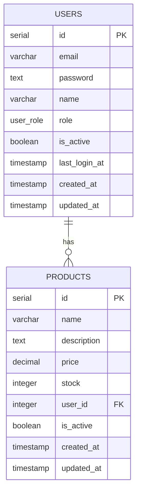

# Database Schema Documentation

**Version:** 1.0.0
**Date:** 2026-07-22

---

## 📊 Database Overview

### Database Type
**PostgreSQL 16** - Relational database with ACID compliance

### Schema Name
`public` (default)

### Total Tables
- Users (2)
- Products (2)

---

## 📋 Tables

### 1. Users Table

#### Table Name
`users`

#### Description
Menyimpan data user untuk autentikasi dan manajemen pengguna.

#### Schema Definition

```sql
CREATE TABLE users (
    id SERIAL PRIMARY KEY,
    email VARCHAR(255) UNIQUE NOT NULL,
    password TEXT NOT NULL,
    name VARCHAR(100) NOT NULL,
    role user_role DEFAULT 'user',
    is_active BOOLEAN DEFAULT true,
    last_login_at TIMESTAMP,
    created_at TIMESTAMP DEFAULT NOW() NOT NULL,
    updated_at TIMESTAMP DEFAULT NOW() NOT NULL
);

-- Indexes
CREATE UNIQUE INDEX email_idx ON users(email);
CREATE INDEX role_idx ON users(role);
```

#### Columns

| Column          | Type         | Constraints      | Default | Description                      |
| --------------- | ------------ | ---------------- | ------- | -------------------------------- |
| `id`            | SERIAL       | PRIMARY KEY      | Auto    | Unique identifier                |
| `email`         | VARCHAR(255) | UNIQUE, NOT NULL | -       | User email (login)               |
| `password`      | TEXT         | NOT NULL         | -       | Hashed password (bcrypt)         |
| `name`          | VARCHAR(100) | NOT NULL         | -       | User full name                   |
| `role`          | user_role    | ENUM             | 'user'  | User role (admin/user/moderator) |
| `is_active`     | BOOLEAN      | -                | true    | Active status (soft delete)      |
| `last_login_at` | TIMESTAMP    | -                | NULL    | Last login timestamp             |
| `created_at`    | TIMESTAMP    | NOT NULL         | NOW()   | Creation timestamp               |
| `updated_at`    | TIMESTAMP    | NOT NULL         | NOW()   | Last update timestamp            |

#### Indexes

| Index Name  | Columns | Type   | Purpose                     |
| ----------- | ------- | ------ | --------------------------- |
| `email_idx` | email   | UNIQUE | Fast email lookup for login |
| `role_idx`  | role    | INDEX  | Filtering users by role     |

#### Relations

| Relation    | Table    | Foreign Key | Type    |
| ----------- | -------- | ----------- | ------- |
| One-to-Many | products | user_id     | CASCADE |

---

### 2. Products Table

#### Table Name

`products`

#### Description

Menyimpan data produk yang dimiliki oleh user.

#### Schema Definition

```sql
CREATE TABLE products (
    id SERIAL PRIMARY KEY,
    name VARCHAR(255) NOT NULL,
    description TEXT,
    price DECIMAL(10,2) NOT NULL,
    stock INTEGER DEFAULT 0 NOT NULL,
    user_id INTEGER REFERENCES users(id) ON DELETE CASCADE,
    is_active BOOLEAN DEFAULT true,
    created_at TIMESTAMP DEFAULT NOW() NOT NULL,
    updated_at TIMESTAMP DEFAULT NOW() NOT NULL
);

-- Indexes
CREATE INDEX user_id_idx ON products(user_id);
CREATE INDEX name_idx ON products(name);
```

#### Columns

| Column        | Type          | Constraints | Default | Description           |
| ------------- | ------------- | ----------- | ------- | --------------------- |
| `id`          | SERIAL        | PRIMARY KEY | Auto    | Unique identifier     |
| `name`        | VARCHAR(255)  | NOT NULL    | -       | Product name          |
| `description` | TEXT          | -           | NULL    | Product description   |
| `price`       | DECIMAL(10,2) | NOT NULL    | -       | Product price         |
| `stock`       | INTEGER       | NOT NULL    | 0       | Available stock       |
| `user_id`     | INTEGER       | FOREIGN KEY | NULL    | Owner user ID         |
| `is_active`   | BOOLEAN       | -           | true    | Product active status |
| `created_at`  | TIMESTAMP     | NOT NULL    | NOW()   | Creation timestamp    |
| `updated_at`  | TIMESTAMP     | NOT NULL    | NOW()   | Last update timestamp |

#### Indexes

| Index Name    | Columns | Type  | Purpose                 |
| ------------- | ------- | ----- | ----------------------- |
| `user_id_idx` | user_id | INDEX | Products by user        |
| `name_idx`    | name    | INDEX | Search products by name |

#### Foreign Keys

| Column    | References | On Delete | Description   |
| --------- | ---------- | --------- | ------------- |
| `user_id` | users.id   | CASCADE   | Product owner |

---

## 🎭 Enums

### 1. user_role

#### Description

Menentukan level akses user dalam sistem.

#### Values

| Value       | Description   | Permissions                          |
| ----------- | ------------- | ------------------------------------ |
| `admin`     | Administrator | Full access, manage users & products |
| `moderator` | Moderator     | Manage products, view users          |
| `user`      | Regular User  | Manage own products, view profile    |

#### Definition

```sql
CREATE TYPE user_role AS ENUM ('admin', 'moderator', 'user');
```

---

## 📊 Relationships

### Entity Relationship Diagram (ERD)



---

## 🔄 Drizzle Schema Definition

### File: `src/config/db.schemas.ts`

```typescript
import {
  pgTable,
  serial,
  varchar,
  text,
  timestamp,
  boolean,
  integer,
  decimal,
  pgEnum,
  uniqueIndex,
  index,
} from "drizzle-orm/pg-core";
import { InferInsertModel, InferSelectModel } from "drizzle-orm";

// === Enums ===
export const userRoleEnum = pgEnum("user_role", ["admin", "moderator", "user"]);

// === Users Table ===
export const users = pgTable(
  "users",
  {
    id: serial("id").primaryKey(),
    email: varchar("email", { length: 255 }).notNull().unique(),
    password: text("password").notNull(),
    name: varchar("name", { length: 100 }).notNull(),
    role: userRoleEnum("role").default("user"),
    isActive: boolean("is_active").default(true),
    lastLoginAt: timestamp("last_login_at"),
    createdAt: timestamp("created_at").defaultNow().notNull(),
    updatedAt: timestamp("updated_at").defaultNow().notNull(),
  },
  (table) => ({
    emailIdx: uniqueIndex("email_idx").on(table.email),
    roleIdx: index("role_idx").on(table.role),
  }),
);

// === Products Table ===
export const products = pgTable(
  "products",
  {
    id: serial("id").primaryKey(),
    name: varchar("name", { length: 255 }).notNull(),
    description: text("description"),
    price: decimal("price", { precision: 10, scale: 2 }).notNull(),
    stock: integer("stock").default(0).notNull(),
    userId: integer("user_id").references(() => users.id, {
      onDelete: "cascade",
    }),
    isActive: boolean("is_active").default(true),
    createdAt: timestamp("created_at").defaultNow().notNull(),
    updatedAt: timestamp("updated_at").defaultNow().notNull(),
  },
  (table) => ({
    userIdIdx: index("user_id_idx").on(table.userId),
    nameIdx: index("name_idx").on(table.name),
  }),
);

// === Types ===
export type User = InferSelectModel<typeof users>;
export type NewUser = InferInsertModel<typeof users>;
export type Product = InferSelectModel<typeof products>;
export type NewProduct = InferInsertModel<typeof products>;
```

---

## 🔍 Query Examples

### Basic Queries

```typescript
// Get all users
const allUsers = await db.select().from(users);

// Get user by email
const user = await db
  .select()
  .from(users)
  .where(eq(users.email, "user@example.com"))
  .limit(1);

// Get all products by user
const userProducts = await db
  .select()
  .from(products)
  .where(eq(products.userId, userId));

// Get product with user details (JOIN)
const productsWithUser = await db
  .select({
    id: products.id,
    name: products.name,
    price: products.price,
    userName: users.name,
    userEmail: users.email,
  })
  .from(products)
  .leftJoin(users, eq(products.userId, users.id));
```

### Insert Examples

```typescript
// Insert new user
const [newUser] = await db
  .insert(users)
  .values({
    email: "user@example.com",
    password: hashedPassword,
    name: "John Doe",
  })
  .returning();

// Insert new product
const [newProduct] = await db
  .insert(products)
  .values({
    name: "Product 1",
    price: "100000",
    stock: 10,
    userId: 1,
  })
  .returning();
```

### Update Examples

```typescript
// Update user
const [updatedUser] = await db
  .update(users)
  .set({ name: "Jane Doe", updatedAt: new Date() })
  .where(eq(users.id, 1))
  .returning();

// Update product stock
const [updatedProduct] = await db
  .update(products)
  .set({ stock: stock + 5, updatedAt: new Date() })
  .where(eq(products.id, 1))
  .returning();
```

### Delete Examples

```typescript
// Delete user (cascade will delete related products)
const [deletedUser] = await db.delete(users).where(eq(users.id, 1)).returning();

// Delete product
const [deletedProduct] = await db
  .delete(products)
  .where(eq(products.id, 1))
  .returning();
```

---

## 📈 Data Migration

### Migration Commands

```bash
# Generate migration from schema changes
npm run db:generate

# Apply migration to database
npm run db:migrate

# Push schema directly (development only)
npm run db:push

# Open database studio
npm run db:studio
```

### Migration Example

```sql
-- drizzle/migrations/0000_initial.sql
CREATE TYPE "public"."user_role" AS ENUM('admin', 'moderator', 'user');

CREATE TABLE "users" (
    "id" serial PRIMARY KEY,
    "email" varchar(255) NOT NULL UNIQUE,
    "password" text NOT NULL,
    "name" varchar(100) NOT NULL,
    "role" "user_role" DEFAULT 'user',
    "is_active" boolean DEFAULT true,
    "last_login_at" timestamp,
    "created_at" timestamp DEFAULT NOW() NOT NULL,
    "updated_at" timestamp DEFAULT NOW() NOT NULL
);

CREATE TABLE "products" (
    "id" serial PRIMARY KEY,
    "name" varchar(255) NOT NULL,
    "description" text,
    "price" decimal(10,2) NOT NULL,
    "stock" integer DEFAULT 0 NOT NULL,
    "user_id" integer REFERENCES users(id) ON DELETE CASCADE,
    "is_active" boolean DEFAULT true,
    "created_at" timestamp DEFAULT NOW() NOT NULL,
    "updated_at" timestamp DEFAULT NOW() NOT NULL
);

CREATE INDEX "email_idx" ON users("email");
CREATE INDEX "role_idx" ON users("role");
CREATE INDEX "user_id_idx" ON products("user_id");
CREATE INDEX "name_idx" ON products("name");
```

---

## 🗄️ Sample Data

### Insert Sample Users

```sql
INSERT INTO users (email, password, name, role) VALUES
('admin@example.com', '$2a$12$...', 'Admin User', 'admin'),
('user@example.com', '$2a$12$...', 'Regular User', 'user'),
('moderator@example.com', '$2a$12$...', 'Moderator', 'moderator');
```

### Insert Sample Products

```sql
INSERT INTO products (name, description, price, stock, user_id) VALUES
('Laptop Pro', 'High-end laptop with 16GB RAM', '15000000', 10, 1),
('Smartphone X', 'Latest smartphone with 5G', '8000000', 20, 1),
('Headphone Pro', 'Noise-cancelling headphones', '2000000', 50, 2),
('Monitor 4K', '27-inch 4K display', '5000000', 15, 2);
```

---

## 🔧 Indexing Strategy

### When to Create Indexes

| Situation     | Index Type | Example              |
| ------------- | ---------- | -------------------- |
| Foreign Keys  | B-Tree     | `userId` in products |
| Unique Fields | UNIQUE     | `email` in users     |
| Search Fields | B-Tree     | `name` in products   |
| Sort Fields   | B-Tree     | `createdAt` in users |

### Index Recommendations

```sql
-- For users table
CREATE INDEX idx_users_created_at ON users(created_at DESC);
CREATE INDEX idx_users_role_active ON users(role, is_active);

-- For products table
CREATE INDEX idx_products_price ON products(price);
CREATE INDEX idx_products_created_at ON products(created_at DESC);
CREATE INDEX idx_products_user_active ON products(user_id, is_active);
```

---

## 🎯 Best Practices

### Database Design Rules

1. **Use Appropriate Data Types**
   - Use `VARCHAR` with length limits
   - Use `TEXT` for unlimited text
   - Use `DECIMAL` for monetary values
   - Use `TIMESTAMP` for dates

2. **Always Define NOT NULL**
   - Add `NOT NULL` to required fields
   - Use `DEFAULT` for optional fields

3. **Use Proper Indexes**
   - Index foreign keys
   - Index columns used in WHERE clauses
   - Don't over-index

4. **Use CASCADE Carefully**
   - Use `ON DELETE CASCADE` where appropriate
   - Be cautious with critical data

5. **Use Soft Delete**
   - Use `is_active` instead of hard delete
   - Keep history of deleted records

---

## 📊 Performance Metrics

### Query Performance Targets

| Operation              | Target Time | Current |
| ---------------------- | ----------- | ------- |
| SELECT (with index)    | < 10ms      | ~5ms    |
| SELECT (without index) | < 50ms      | ~30ms   |
| INSERT                 | < 20ms      | ~10ms   |
| UPDATE                 | < 20ms      | ~15ms   |
| DELETE                 | < 20ms      | ~10ms   |

### Monitoring Queries

```sql
-- Check query performance
SELECT
    query,
    calls,
    total_time,
    mean_time
FROM pg_stat_statements
ORDER BY mean_time DESC
LIMIT 10;

-- Check table sizes
SELECT
    tablename,
    pg_size_pretty(pg_total_relation_size(tablename)) as size
FROM pg_tables
WHERE schemaname = 'public';
```

---

## 🔐 Security Considerations

### Data Protection

1. **Password Hashing**
   - Use bcrypt with salt rounds 12
   - Never store plain passwords

2. **SQL Injection Prevention**
   - Use Drizzle ORM (parameterized queries)
   - Validate all inputs with Zod

3. **Data Exposure**
   - Never expose password fields
   - Use select queries with specific fields

4. **Audit Trail**
   - Track `created_at` and `updated_at`
   - Log all critical operations

---

## 📚 Reference

### Drizzle ORM Documentation

- https://orm.drizzle.team/

### PostgreSQL Documentation

- https://www.postgresql.org/docs/16/

### JWT Documentation

- https://jwt.io/introduction
- https://github.com/fastify/fastify-jwt
